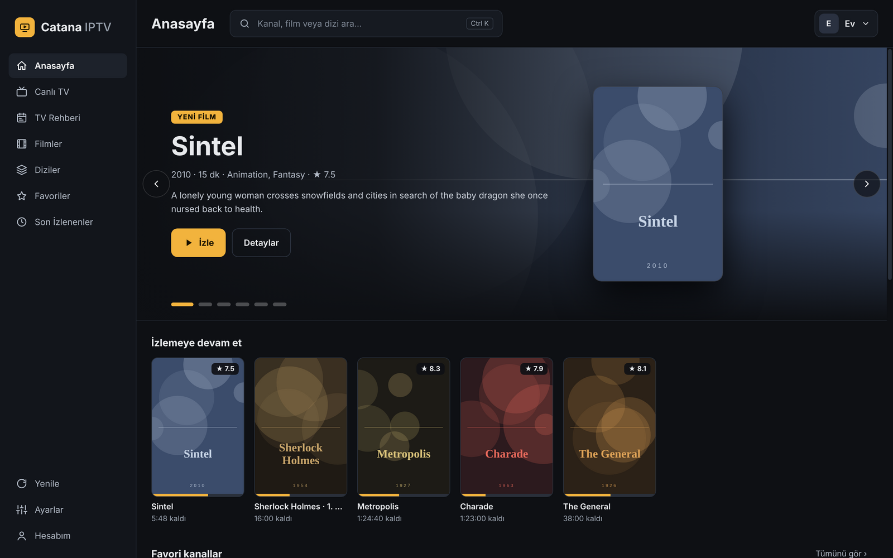

<div align="center">


# Catana IPTV

**A clean, modern desktop player for Xtream Codes IPTV — Windows & macOS.**

[](https://github.com/hakancatana/catana-iptv/releases/latest)


[](LICENSE)

[**Download**](#download) · [Features](#features) · [Screenshots](#screenshots) · [Build from source](#build-from-source) · [Türkçe](#türkçe)


</div>

## Download

| Platform | File |
|---|---|
| **Windows** 10 / 11 (64-bit) | [`Catana-IPTV-Setup-1.3.1.exe`](https://github.com/hakancatana/catana-iptv/releases/latest) |
| **macOS** Apple Silicon (M1–M4) | [`Catana-IPTV-1.3.1-mac-AppleSilicon.zip`](https://github.com/hakancatana/catana-iptv/releases/latest) |
| **macOS** Intel | [`Catana-IPTV-1.3.1-mac-Intel.zip`](https://github.com/hakancatana/catana-iptv/releases/latest) |

> The builds are not code-signed yet.
> **Windows:** if SmartScreen appears, click *More info → Run anyway*.
> **macOS:** move the app to *Applications*, try to open it once, then go to *System Settings → Privacy & Security* and click *Open Anyway*.

## Features

**Live TV**
- Channel logo grid or list view with live preview and schedule
- **Rewind live TV** up to 30 minutes, jump back with the *LIVE* button — like YouTube
- Quick channel panel inside the player with categories, *All* and *Favourites*
- ↑ / ↓ to zap, **Backspace** to jump to the previous channel
- Full **TV guide** (EPG grid) with a now-line and programme details

**Movies & Series**
- Home screen with a featured slider, *Continue watching*, recent movies and series
- Movie pages with plot, cast, director, trailer link and resume / start over
- Series pages with seasons, episode thumbnails and *Continue S1 E5*
- Global search across channels, movies and series (`Ctrl/⌘ + K`)

**Player**
- MPEG-TS and HLS playback with automatic fallback
- Settings panel: audio language, subtitles, quality, buffer size, aspect ratio, live statistics
- Keeps the screen awake while playing

**Account & privacy**
- Multiple Xtream profiles; passwords stored encrypted (Windows DPAPI / macOS Keychain)
- Hide categories you never use; hide adult categories or protect them with a 4-digit PIN
- Account details (expiry, connection limit), device check (latency, speed, codec support)

**9 languages** — Türkçe, English, Deutsch, Français, Español, Italiano, Русский, 简体中文, हिन्दी

## Screenshots

<table>
<tr>
<td width="50%"><br><sub><b>Live TV</b> — logo grid with categories and favourites</sub></td>
<td width="50%"><br><sub><b>List view</b> — live preview and schedule</sub></td>
</tr>
<tr>
<td><br><sub><b>TV guide</b> — full EPG grid</sub></td>
<td><br><sub><b>Player</b> — rewind live TV, back to live in one click</sub></td>
</tr>
<tr>
<td><br><sub><b>Channel panel</b> — switch channels by category</sub></td>
<td><br><sub><b>Player settings</b> — audio, subtitles, buffer, statistics</sub></td>
</tr>
<tr>
<td><br><sub><b>Movie details</b> — resume where you left off</sub></td>
<td><br><sub><b>Series</b> — seasons and episodes</sub></td>
</tr>
<tr>
<td><br><sub><b>Search</b> — everything in one place</sub></td>
<td><br><sub><b>Settings</b> — language, stream format, buffer, view</sub></td>
</tr>
<tr>
<td><br><sub><b>My account</b> — profile, categories, parental PIN, device check</sub></td>
<td><br><sub><b>Profiles</b> — several Xtream accounts</sub></td>
</tr>
</table>

<sub>Screenshots use a demo server: freely available channels, public-domain classics and open Blender films. Posters are original placeholder artwork.</sub>

## Keyboard shortcuts

| Key | Action |
|---|---|
| `Space` | Play / pause |
| `↑` `↓` | Previous / next channel |
| `←` `→` | 10 seconds back / forward (live TV too) |
| `L` | Back to live |
| `Backspace` | Previous channel |
| `C` | Channel panel |
| `S` | Player settings |
| `F` / double-click | Full screen |
| `M` | Mute |
| `Ctrl/⌘ + K` | Search |

## Build from source

Requires Node.js 20+.

```bash
git clone https://github.com/hakancatana/catana-iptv.git
cd catana-iptv
npm install
npm start            # run the app
npm run dist         # Windows installer (dist/)
npm run dist:mac     # macOS builds (best run on a Mac)
```

Built with [Electron](https://www.electronjs.org/), [mpegts.js](https://github.com/xqq/mpegts.js) and [hls.js](https://github.com/video-dev/hls.js). No framework, no build step for the UI — plain HTML, CSS and JavaScript in [`src/`](src).

## Disclaimer

Catana IPTV is a media player only. It does not include, host or provide any channels, playlists or other content. Use it only with services and content you are legally entitled to access.

## Türkçe

**Catana IPTV**, Xtream Codes için Windows ve macOS masaüstü IPTV oynatıcısıdır.

- **İndir:** [Son sürüm](https://github.com/hakancatana/catana-iptv/releases/latest). Windows için `Setup.exe`, Mac için işlemcine uygun zip.
- **Canlı TV:** Logo ızgarası ya da önizlemeli liste görünümü var. Canlı yayını 30 dakikaya kadar geri sarabilir, *CANLI* düğmesiyle en güncel ana dönebilirsin. Ayrıca tam TV rehberi var.
- **Film ve dizi:** Anasayfada öne çıkanlar slider'ı ve *İzlemeye devam et* satırı var. Detay sayfalarında konu, oyuncular ve fragman bulunuyor. Dizilerde sezon ve bölüm listesi var.
- **Oynatıcı:** Ses dili, altyazı, kalite, önbellek ve görüntü oranı ayarlanabiliyor, canlı istatistikler de gösteriliyor. Backspace önceki kanala döndürür.
- **Hesap:** Birden fazla profil kaydedilebiliyor, şifreler şifreli saklanıyor. Kullanmadığın kategorileri gizleyebilir, yetişkin içeriği gizleyebilir ya da PIN ile koruyabilirsin. Cihaz analizi bölümü de var.
- **Diller:** 9 dil desteklenir; Ayarlar › Dil.

<div align="center"></div>

## License

[MIT](LICENSE) © Mustafa Hakan Çatana
