<div align="center">


# Catana IPTV

**A clean, modern desktop player for Xtream Codes IPTV — Windows, macOS & Linux.**

[](https://github.com/hakancatana/catana-iptv/releases/latest)


[](LICENSE)

[**Download**](#download) · [Features](#features) · [Screenshots](#screenshots) · [Build from source](#build-from-source)

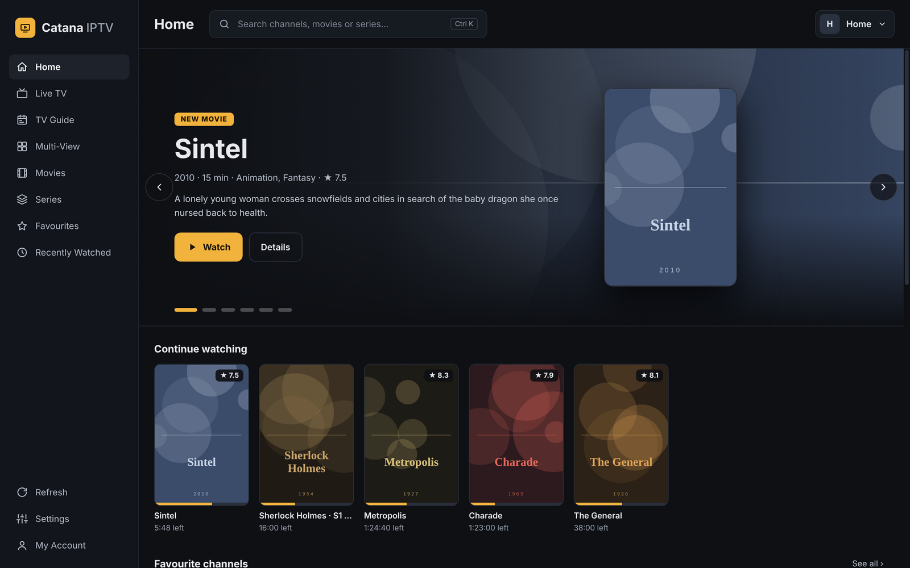

</div>

## Download

Get the latest version from the **[Releases page](https://github.com/hakancatana/catana-iptv/releases/latest)**:

| Platform | File |
|---|---|
| **Windows** 10 / 11 (64-bit) | `Catana-IPTV-Setup-<version>.exe` |
| **macOS** Apple Silicon (M1–M4) | `Catana-IPTV-<version>-mac-arm64.zip` |
| **macOS** Intel | `Catana-IPTV-<version>-mac-x64.zip` |
| **Ubuntu / Linux Mint / Debian** (64-bit) | `catana-iptv_<version>_amd64.deb` |
| **Fedora / RHEL / openSUSE** (64-bit) | `catana-iptv-<version>.x86_64.rpm` |
| **Any Linux** (64-bit, no install) | `Catana-IPTV-<version>-x86_64.AppImage` |

The app checks for new versions on start-up; on Windows it can download and install the update for you, on macOS and Linux it opens the download page.

> The builds are not code-signed yet.
> **Windows:** if SmartScreen appears, click *More info → Run anyway*.
> **macOS:** move the app to *Applications*, try to open it once, then go to *System Settings → Privacy & Security* and click *Open Anyway*.

**Linux install**

```bash
# Ubuntu / Linux Mint / Debian
sudo apt install ./catana-iptv_<version>_amd64.deb

# Fedora
sudo dnf install ./catana-iptv-<version>.x86_64.rpm

# AppImage (any distribution; Ubuntu 22.04+ needs: sudo apt install libfuse2t64 — or libfuse2 on 22.04)
chmod +x Catana-IPTV-<version>-x86_64.AppImage && ./Catana-IPTV-<version>-x86_64.AppImage
```

On Linux, passwords are encrypted with the system keyring (GNOME Keyring / KWallet) when one is available.

## Features

**Live TV**
- Channel logo grid or list view with live preview and schedule
- **Rewind live TV** up to 30 minutes, jump back with the *LIVE* button — like YouTube
- Quick channel panel inside the player with categories, *All* and *Favourites*
- ↑ / ↓ to zap, **Backspace** to jump to the previous channel
- Full **TV guide** (EPG grid) with a now-line and programme details

**Movies & Series**
- Home screen with a featured slider, *Continue watching*, recent movies and series
- Movie pages with plot, cast, director, trailer link and resume / start over
- Series pages with seasons, episode thumbnails and *Continue S1 E5*
- Global search across channels, movies and series (`Ctrl/⌘ + K`)

**Player**
- MPEG-TS and HLS playback with automatic fallback
- Settings panel: audio language, subtitles, quality, buffer size, aspect ratio, live statistics
- **Mini player** (picture-in-picture) keeps playing while you use other apps
- Keeps the screen awake while playing

**Account & privacy**
- Multiple Xtream profiles; passwords stored encrypted (Windows DPAPI / macOS Keychain / Linux keyring)
- Hide categories you never use; hide adult categories or protect them with a 4-digit PIN
- Account details (expiry, connection limit), device check (latency, speed, codec support)

**9 languages** — English, Deutsch, Français, Español, Italiano, Türkçe, Русский, 简体中文, हिन्दी

## Screenshots

<table>
<tr>
<td width="50%">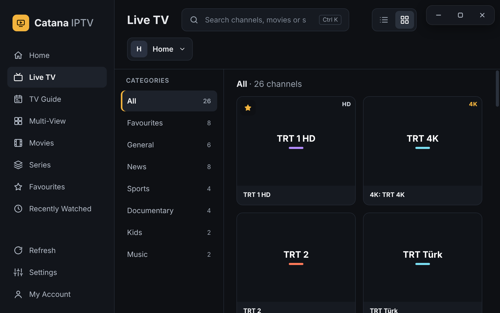<br><sub><b>Live TV</b> — logo grid with categories and favourites</sub></td>
<td width="50%">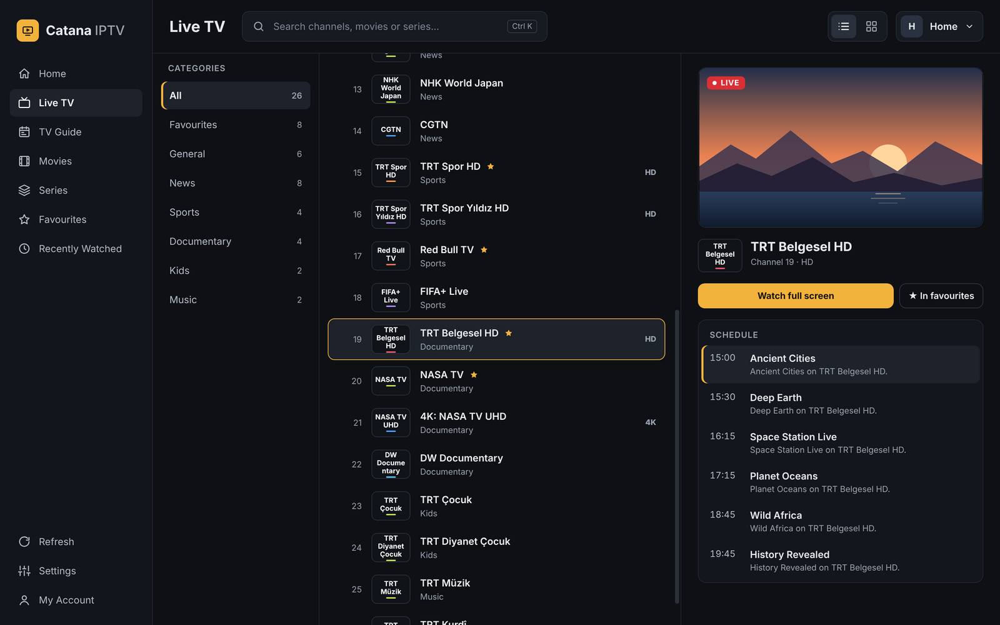<br><sub><b>List view</b> — live preview and schedule</sub></td>
</tr>
<tr>
<td>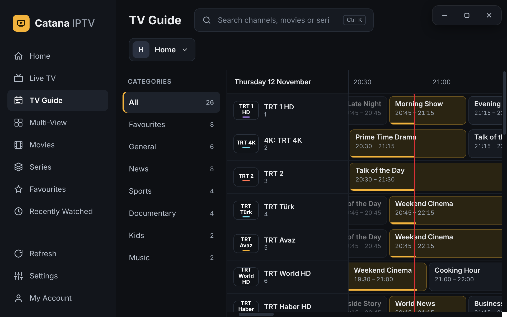<br><sub><b>TV guide</b> — full EPG grid</sub></td>
<td>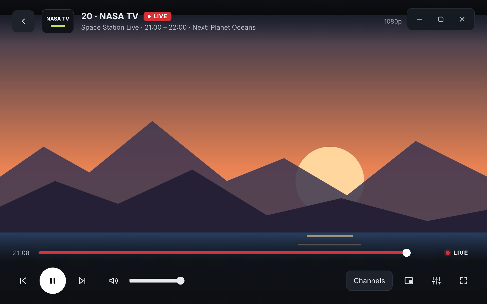<br><sub><b>Player</b> — rewind live TV, back to live in one click</sub></td>
</tr>
<tr>
<td>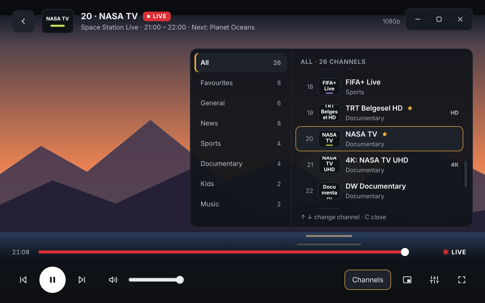<br><sub><b>Channel panel</b> — switch channels by category</sub></td>
<td>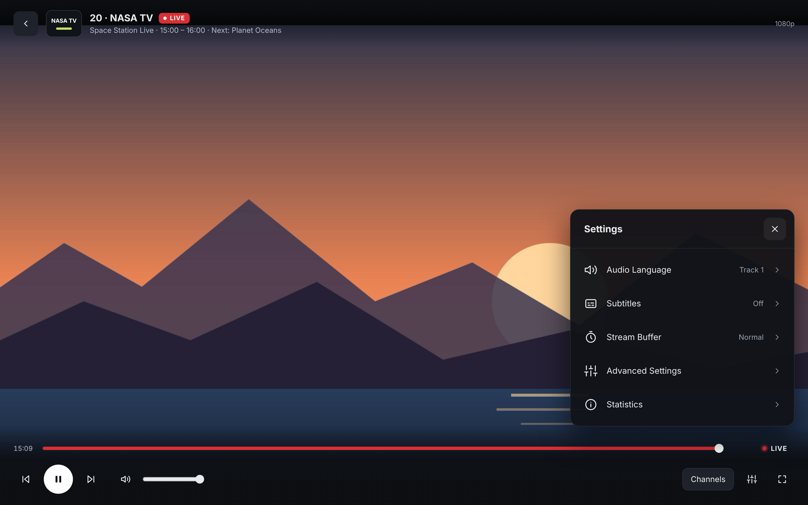<br><sub><b>Player settings</b> — audio, subtitles, buffer, statistics</sub></td>
</tr>
<tr>
<td>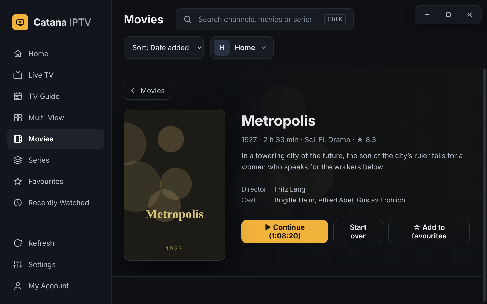<br><sub><b>Movie details</b> — resume where you left off</sub></td>
<td>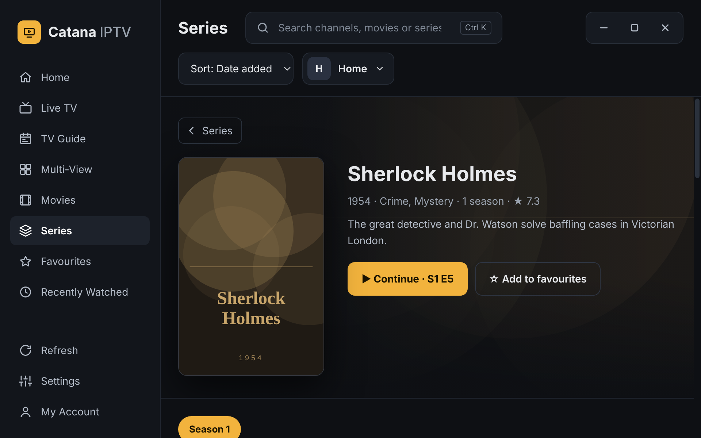<br><sub><b>Series</b> — seasons and episodes</sub></td>
</tr>
<tr>
<td>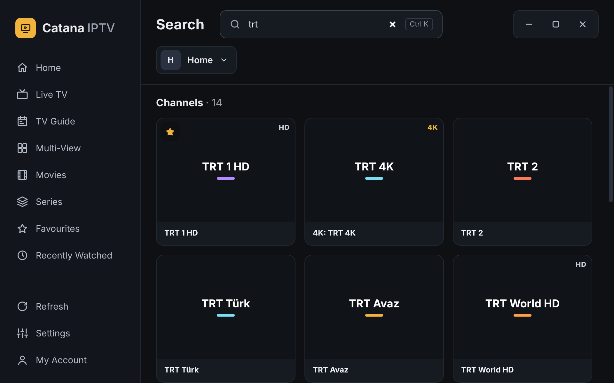<br><sub><b>Search</b> — everything in one place</sub></td>
<td>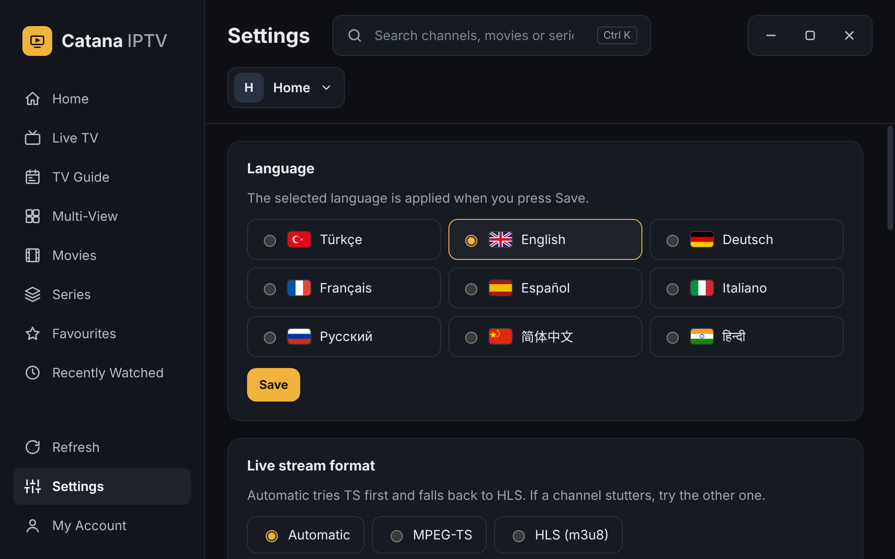<br><sub><b>Settings</b> — language, stream format, buffer, view</sub></td>
</tr>
<tr>
<td>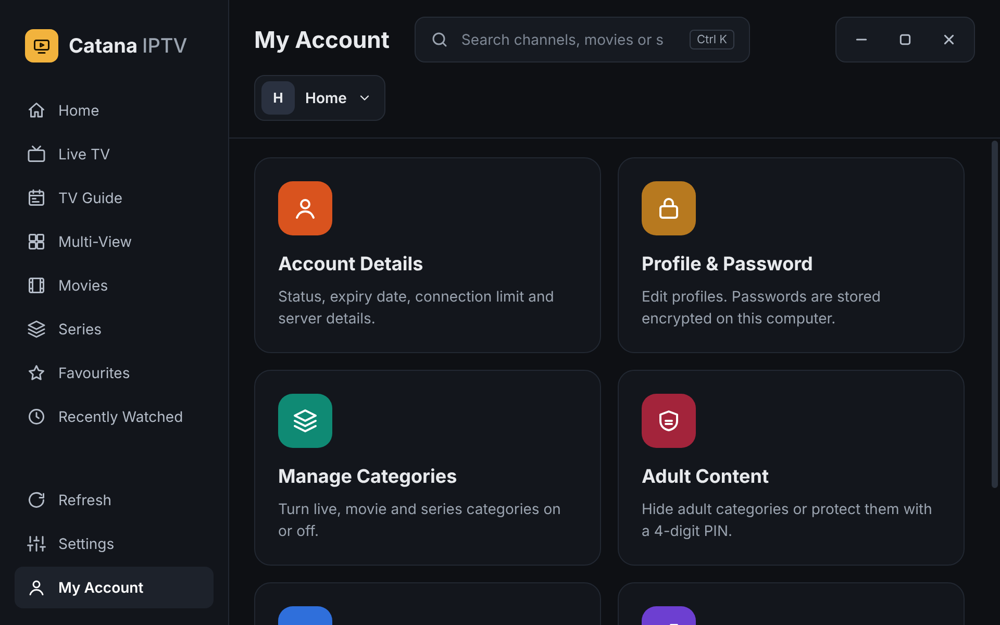<br><sub><b>My account</b> — profile, categories, parental PIN, device check</sub></td>
<td>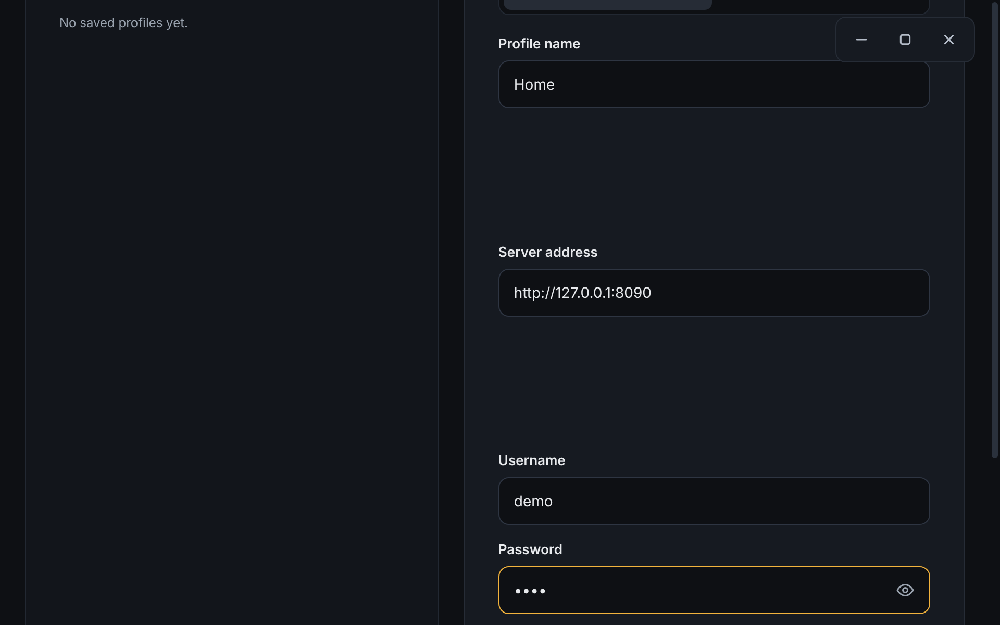<br><sub><b>Profiles</b> — several Xtream accounts</sub></td>
</tr>
</table>

<sub>Screenshots use a demo server: freely available channels, public-domain classics and open Blender films. Posters are original placeholder artwork.</sub>

## Keyboard shortcuts

| Key | Action |
|---|---|
| `Space` | Play / pause |
| `↑` `↓` | Previous / next channel |
| `←` `→` | 10 seconds back / forward (live TV too) |
| `L` | Back to live |
| `Backspace` | Previous channel |
| `C` | Channel panel |
| `S` | Player settings |
| `F` / double-click | Full screen |
| `M` | Mute |
| `P` | Mini player |
| `Ctrl/⌘ + K` | Search |

## Build from source

Requires Node.js 20+.

```bash
git clone https://github.com/hakancatana/catana-iptv.git
cd catana-iptv
npm install
npm start            # run the app
npm run dist         # Windows installer (dist/)
npm run dist:mac     # macOS builds (best run on a Mac)
npm run dist:linux   # AppImage, .deb and .rpm (needs rpmbuild for .rpm)
```

Built with [Electron](https://www.electronjs.org/), [mpegts.js](https://github.com/xqq/mpegts.js) and [hls.js](https://github.com/video-dev/hls.js). No framework, no build step for the UI — plain HTML, CSS and JavaScript in [`src/`](src).

## Releasing

1. Bump `version` in `package.json` and push to `main`.
2. Go to **Actions → Release → Run workflow**.

GitHub Actions builds the Windows installer, the macOS packages and the Linux packages, creates the `v<version>` tag and publishes the release. Installed apps pick up the new version automatically.

## Disclaimer

Catana IPTV is a media player only. It does not include, host or provide any channels, playlists or other content. Use it only with services and content you are legally entitled to access.

## License

[MIT](LICENSE) © Mustafa Hakan Çatana
